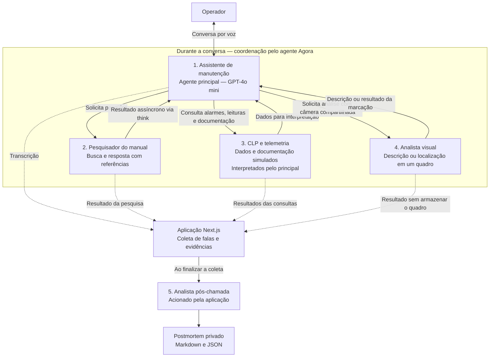
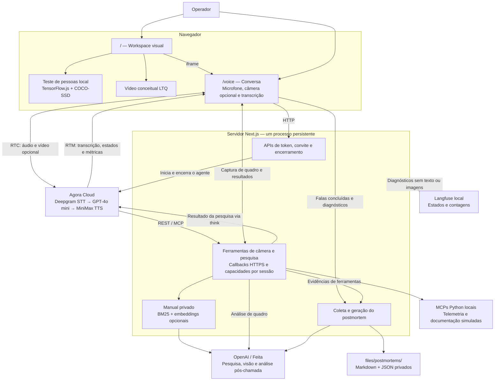
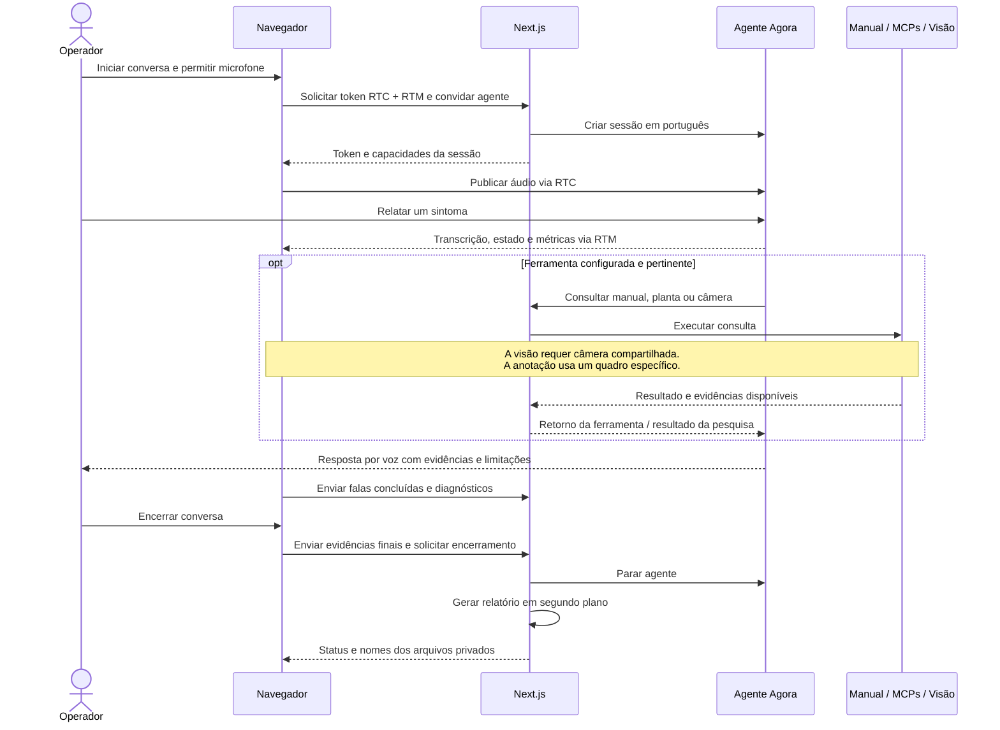

# Unmute

**POC de assistência à manutenção industrial por voz, com IA em português, consulta a manuais, visão por câmera e integração com uma planta LTQ simulada.**

A Unmute explora uma conversa natural entre operador e assistente para investigar sintomas de equipamentos. O operador relata o problema pelo microfone; a assistente consulta as fontes configuradas, apresenta as evidências disponíveis e informa quando faltam dados para orientar o próximo passo. A câmera pode complementar a conversa quando houver uma dúvida visual ou um pedido explícito.

O cenário de demonstração é uma **linha de laminação de tiras a quente (LTQ)**. O projeto reúne voz em tempo real, pesquisa documental, ferramentas MCP, experimentos visuais e relatórios de chamada em uma aplicação Next.js.

> Status: prova de conceito local. As leituras da planta são simuladas e os recursos visuais são demonstrativos. A aplicação ainda exige validação técnica e controles de produção antes de uso operacional.

## Recursos

| Recurso | O que demonstra |
| --- | --- |
| Conversa em português brasileiro | Áudio em tempo real, interrupção da resposta, transcrição e métricas de latência com Agora. |
| Consulta a manuais | Busca híbrida por palavras e significado, com respostas baseadas em trechos e citações de seção ou página. |
| Ferramentas da planta | Consulta a alarmes, leituras, histórico, códigos e tags de 17 equipamentos simulados via MCP. |
| Câmera na conversa | Compartilhamento opcional de vídeo e análise de um quadro para descrever ou destacar objetos por voz. |
| Teste local de pessoas | Detecção no navegador, com câmera ou imagem de exemplo, caixas/círculos e filtro de confiança. |
| Demonstração LTQ | Vídeo conceitual de uma cadeira acabadora gerado no Tripo. |
| Relatório pós-chamada | Markdown e JSON privados com falas, evidências, linha do tempo, limitações e próximas ações. |
| Observabilidade | Traces opcionais no Langfuse para acompanhar conexão, ferramentas e resultados. |

## Papéis e orquestração

O fluxo tem **5 papéis funcionais: 1 agente principal e 4 funções de apoio**. Durante a conversa, o agente principal no Agora coordena pesquisa documental, consultas ao CLP e análise visual, quando esses recursos estão configurados. A aplicação coordena a geração do postmortem após finalizar a coleta da chamada.

| Papel | Responsabilidade | Quem aciona | Modelo padrão |
| --- | --- | --- | --- |
| **1. Assistente de manutenção** | Conversa com o operador, entende o relato, escolhe as consultas e responde por voz com as evidências disponíveis. | Operador, pela conversa no Agora. | `gpt-4o-mini`, gerenciado pelo Agora. |
| **2. Pesquisador do manual** | Busca trechos do manual e sintetiza uma resposta com referências de seção ou página. | Agente principal; há um fallback pela transcrição final para relatos pertinentes, sem duplicar pesquisas já iniciadas. | `gpt-5.4-mini`, configurável por `OPENAI_RAG_MODEL`. |
| **3. CLP e telemetria da planta** | Fornece alarmes, leituras atuais, histórico e documentação de códigos e tags dos equipamentos simulados. | Agente principal, que cruza os dados com a documentação e interpreta o resultado. | Sem modelo próprio; a interpretação fica no agente principal. |
| **4. Analista visual** | Descreve um quadro da câmera ou localiza um objeto para marcá-lo na imagem enviada. | Agente principal, diante de um pedido visual e com a câmera compartilhada. | `gpt-4o-mini`, configurável por `OPENAI_VISION_MODEL`. |
| **5. Analista pós-chamada** | Consolida falas e evidências em um postmortem com linha do tempo, análise, limitações e próximas ações. | Aplicação, após finalizar a coleta, fora da orquestração conversacional do Agora. | `OPENAI_POSTMORTEM_MODEL`, ou `OPENAI_RAG_MODEL`, ou `gpt-5.4-mini`, nessa ordem. |

Na implementação atual, **somente o principal é uma sessão de agente Agora**. Pesquisa, visão e postmortem são rotinas de IA com prompts próprios. CLP/telemetria reúne serviços de dados e documentação simulados, cuja interpretação cabe ao principal. Assim, a contagem descreve responsabilidades no fluxo, sem atribuir sessões autônomas aos quatro apoios.



Pesquisa, visão e postmortem usam o adaptador de provedores do servidor, com Feita como alternativa/fallback quando configurada. Essa configuração não altera o modelo de voz gerenciado pelo Agora. O teste local de pessoas e o vídeo conceitual LTQ permanecem independentes desses papéis.

As responsabilidades estão implementadas em [`app/api/invite-agent/route.ts`](app/api/invite-agent/route.ts), [`lib/document-research.ts`](lib/document-research.ts), [`lib/plant-mcp.ts`](lib/plant-mcp.ts), [`lib/vision-annotation-server.ts`](lib/vision-annotation-server.ts), [`lib/ai-provider.ts`](lib/ai-provider.ts) e [`lib/postmortem.ts`](lib/postmortem.ts).

## Arquitetura



A voz usa o pipeline STT → LLM → TTS gerenciado pelo Agora, configurado em [`app/api/invite-agent/route.ts`](app/api/invite-agent/route.ts). A configuração básica exige apenas as credenciais Agora; as chamadas adicionais à OpenAI/Feita pertencem aos recursos opcionais de pesquisa, visão e análise. A interface usa Next.js 16, React 19 e TypeScript.

O teste local de pessoas processa imagens no navegador e mantém suas marcações nesse painel. O compartilhamento da câmera na conversa é um controle separado, que envia vídeo ao Agora somente após a ação do usuário.

## Fluxo de uma conversa



A pesquisa documental entra em uma fila e devolve um ID imediatamente, permitindo continuar a conversa enquanto o resultado é preparado. Quando termina, o servidor entrega o resultado ao modelo Agora da mesma chamada. A assistente deve distinguir relatos, hipóteses, dados simulados e fatos sustentados pelas fontes.

## Executar localmente

### Pré-requisitos

- Node.js **22 ou superior** e **pnpm**.
- Projeto Agora com **Conversational AI** e **Signaling** habilitados para chamadas reais.
- Navegador com microfone; câmera opcional. A captura de mídia exige localhost ou HTTPS.
- Python **3.11+** para os MCPs simulados; Docker Compose para o Langfuse; ngrok para a demonstração externa. Esses recursos são opcionais.

### Instalação

Na raiz deste checkout:

```bash
pnpm install
cp -n env.local.example .env.local
```

Preencha as duas variáveis obrigatórias em `.env.local`:

```dotenv
NEXT_PUBLIC_AGORA_APP_ID=seu-app-id
NEXT_AGORA_APP_CERTIFICATE=seu-app-certificate
```

O App Certificate permanece no servidor. O arquivo `.env.local` é ignorado pelo Git.

```bash
pnpm run doctor
pnpm run dev
```

Abra a URL exibida no terminal, normalmente [http://localhost:3000](http://localhost:3000). A rota `/` reúne o teste visual e a conversa; `/voice` abre somente a experiência de voz. Clique em **Iniciar conversa**, permita o microfone e relate o problema. Use **Encerrar conversa** para finalizar a sessão.

Com a [Agora CLI](https://github.com/AgoraIO-Community/cli) já instalada, também é possível configurar as credenciais pelo projeto:

```bash
agora login
agora project use <seu-projeto>
agora project env write .env.local
agora project doctor --deep
```

Sem credenciais, o teste local com **Usar exemplo** continua disponível, assim como lint, typecheck, verificações de API e build. Áudio, transcrição e latência reais exigem uma chamada Agora.

## Configuração dos recursos opcionais

Use [`env.local.example`](env.local.example) como referência. Reinicie o servidor e abra uma **nova chamada** após alterar a configuração.

| Variável | Uso |
| --- | --- |
| `OPENAI_API_KEY` | Provedor principal para pesquisa, análise de câmera, embeddings e postmortem. |
| `FEITA_API_KEY` | Alternativa/fallback para respostas do manual, visão e postmortem. |
| `AGORA_ANNOTATION_ORIGIN` | Origem HTTPS pública deste Next.js, usada nos callbacks de visão e nos MCPs. |
| `RAG_DOCUMENT_PATH` | Caminho para um manual privado em Markdown ou texto UTF-8. |
| `RAG_DOCUMENT_TITLE` / `RAG_DOCUMENT_LANGUAGE` | Título para citações e idioma da fonte para auxiliar a busca. |
| `OPENAI_RAG_MODEL` | Modelo de resposta documental; padrão `gpt-5.4-mini`. |
| `OPENAI_VISION_MODEL` | Modelo de visão; padrão `gpt-4o-mini`. |
| `OPENAI_POSTMORTEM_MODEL` | Modelo do relatório; usa `OPENAI_RAG_MODEL` ou `gpt-5.4-mini` por padrão. |
| `FEITA_MODEL` | Modelo da Feita; padrão `qwen/qwen4-max`. |
| `PLANTA_MCP_TOKEN` | Segredo compartilhado entre Next.js e os dois MCPs Python. |
| `LANGFUSE_BASE_URL`, `LANGFUSE_PUBLIC_KEY`, `LANGFUSE_SECRET_KEY` | Exportação de traces para o Langfuse local. |

### Consulta ao manual por voz

1. Guarde a fonte fora de `public/` e do Git, por exemplo em `.rag/manual.md`.
2. Configure `RAG_DOCUMENT_PATH`, um provedor de IA e `AGORA_ANNOTATION_ORIGIN`.
3. Defina `RAG_DOCUMENT_TITLE` e, se a fonte estiver em outro idioma, `RAG_DOCUMENT_LANGUAGE`.
4. Inicie uma chamada e diga, por exemplo: “O rolamento está esquentando e fazendo barulho. O que eu devo verificar?”.

O MCP `ManualManutencaoLTQ` oferece `consultar_manual_de_manutencao` e `consultar_resultado`. O prompt atual direciona sintomas de rolamentos para essa pesquisa; um fallback pela transcrição final pode encaminhar falas pertinentes quando a chamada MCP não ocorreu, evitando duplicação de jobs. O resultado aparece no painel e volta ao agente de voz. **Ouvir resposta** permite repetir a leitura.

A busca combina BM25 com embeddings da OpenAI e mantém o cache em `.rag/vectors/`. A primeira indexação envia os trechos da fonte à API de embeddings; cada pesquisa envia a pergunta, e a síntese recebe apenas os trechos recuperados. Sem embeddings disponíveis, a busca usa BM25. Títulos Markdown permitem citar seções; texto extraído de PDF com separadores form feed preserva referências de página.

### MCPs da planta simulada

Os serviços Python compartilham um catálogo de 17 equipamentos e funcionam independentemente da pesquisa no manual SKF:

| Servidor | Ferramentas | Endereço local |
| --- | --- | --- |
| `TelemetriaCLPLTQ` | `status_clp`, `status_maquina`, `historico` | `127.0.0.1:8011` |
| `DocumentacaoPlantaLTQ` | `consultar_documentacao_equipamento_ltq`, `consultar_manual_clp` | `127.0.0.1:8012` |

```bash
python3 -m venv planta-mcp/.venv
planta-mcp/.venv/bin/pip install ./planta-mcp
```

Gere um segredo com `openssl rand -hex 32`. Defina o mesmo `PLANTA_MCP_TOKEN` em `.env.local` e como variável de ambiente nos dois terminais Python. Execute um serviço em cada terminal:

```bash
planta-mcp/.venv/bin/planta-mcp telemetria
```

```bash
planta-mcp/.venv/bin/planta-mcp documentacao
```

Configure `AGORA_ANNOTATION_ORIGIN` com a origem HTTPS pública do Next.js. O app encaminha `/api/planta/telemetria` e `/api/planta/documentacao` para os serviços no mesmo host, com autenticação Bearer. Token vazio desativa essas ferramentas na voz.

Teste: “Quais alarmes estão ativos na F5?”, “O que a tag AI012 mede?” ou “Como essa variável mudou na última hora?”. **Todas as leituras são simuladas.**

### Câmera e marcação por voz

Na conversa, clique em **Compartilhar câmera** e permita vídeo. **Usar frontal** / **Usar traseira** troca a lente; **Parar vídeo** encerra o envio sem encerrar a chamada. Compartilhar libera primeiro a câmera do teste local. Se a permissão falhar no painel incorporado, abra `/voice` diretamente.

Com um provedor de IA e `AGORA_ANNOTATION_ORIGIN` configurados, as ferramentas `observar_camera` e `circular_objeto` permitem pedir “O que você está vendo?” ou “Circule a garrafa”. O navegador captura um JPEG e o servidor solicita a análise. A marcação aparece sobre o quadro congelado enviado; **Voltar ao vídeo** retoma a prévia. As coordenadas são aproximadas e as imagens não são persistidas pelo servidor.

### Testes visuais e modelo LTQ

Em **Teste de pessoas**, use **Ativar câmera** ou **Usar exemplo**. Ajuste **Confiança mínima**, alterne **Caixa/Círculo** e use **Parar** para limpar as marcações e liberar a câmera. Trocar para **Modelo LTQ** também libera a câmera.

O COCO-SSD/TensorFlow.js usa WebGL ou CPU no navegador. Os pesos e a imagem de exemplo ficam em [`public/vision-demo/`](public/vision-demo/), com atribuições e licença; o primeiro carregamento transfere cerca de 18 MB. O detector localiza pessoas, sem reconhecer identidades ou diagnosticar equipamentos.

A aba **Modelo LTQ** reproduz [`public/models/ltq-cadeira-acabadora.mp4`](public/models/ltq-cadeira-acabadora.mp4), com controles nativos. É uma demonstração conceitual gerada no Tripo, sem seleção de peças ou controle por voz. A exportação GLB exige um plano Tripo compatível e nenhum GLB está incluído nesta POC.

### Relatório pós-chamada

Ao encerrar, a aplicação gera em segundo plano um postmortem em português e mostra seu andamento e os nomes dos arquivos. Markdown e JSON ficam em `files/postmortems/`, pasta privada ignorada pelo Git. A coleta funciona independentemente da pesquisa documental.

O relatório inclui resumo, contexto, linha do tempo, evidências, análise, desfecho, próximas ações, qualidade técnica e limitações. Ele armazena falas concluídas/interrompidas e resultados limitados de ferramentas, com referências às evidências. Os horários indicam recebimento; encerrar a chamada não comprova resolução ou causa raiz. Jobs de ferramentas ainda pendentes não são aguardados nem incorporados depois.

A análise usa OpenAI e/ou Feita, enviando as evidências ao provedor configurado. Sem provedor ou em caso de falha, salva um relatório básico. **Tentar gerar novamente** permite até duas novas gerações enquanto a sessão estiver disponível.

A coleta limita cada sessão a 300 falas, 500 eventos e 160 mil caracteres, com até 5 mil caracteres por fala. Fechar a página tenta finalizar por `keepalive`; dois minutos sem heartbeat também encerram a coleta como perda de contato, sem comprovar o desligamento do Agora. O processo salva um checkpoint JSON antes da geração. Reiniciá-lo perde coletas e jobs em memória; checkpoints interrompidos não são retomados automaticamente. As capacidades de consulta/repetição expiram uma hora após o encerramento; os arquivos permanecem no disco, com retenção manual.

### Langfuse local

O Compose em [`ops/langfuse/compose.yml`](ops/langfuse/compose.yml) mantém o painel em loopback. Prepare `.langfuse/.env` com as variáveis exigidas pelo Compose: `LANGFUSE_NEXTAUTH_SECRET`, `LANGFUSE_POSTGRES_PASSWORD`, `LANGFUSE_SALT`, `LANGFUSE_ENCRYPTION_KEY`, `LANGFUSE_CLICKHOUSE_PASSWORD`, `LANGFUSE_REDIS_PASSWORD`, `LANGFUSE_MINIO_PASSWORD`, `LANGFUSE_PUBLIC_KEY`, `LANGFUSE_SECRET_KEY`, `LANGFUSE_USER_EMAIL` e `LANGFUSE_USER_PASSWORD`.

```bash
docker compose --env-file .langfuse/.env -f ops/langfuse/compose.yml up -d
```

Abra [http://localhost:3100](http://localhost:3100). Configure `LANGFUSE_BASE_URL=http://127.0.0.1:3100` e as chaves do projeto no `.env.local` do Next.js. Novas chamadas correlacionam convite, microfone, câmera, descoberta/chamada de ferramentas e pesquisa em um trace. Os campos Input/Output contêm apenas estados e contagens, sem áudio, quadros, transcrições ou trechos do manual. Os relatórios pós-chamada têm armazenamento separado e contêm texto da conversa.

### Retry e fallback

O adaptador [`lib/ai-provider.ts`](lib/ai-provider.ts) faz até duas novas tentativas por provedor em falhas transitórias, com backoff de 200/400 ms, jitter e respeito a `Retry-After` e ao prazo total. Quando configurada, a Feita recebe a pergunta e os trechos recuperados ou o quadro solicitado se a OpenAI falhar; também pode ser usada como único provedor de chat. Para embeddings, a alternativa é BM25. A voz continua no Agora.

## Demonstração no celular

Gere e sirva o build de produção:

```bash
pnpm run build
pnpm start --hostname 127.0.0.1 --port 3002
```

Em outro terminal:

```bash
ngrok http 3002
```

Abra a URL HTTPS emitida no celular e aceite a página informativa do ngrok. Câmera e microfone têm permissões e controles separados. Para ferramentas de voz, configure essa origem em `AGORA_ANNOTATION_ORIGIN`, reinicie o servidor e inicie uma nova chamada. Mantenha servidor e túnel ativos; alterações de código exigem novo build e reinício. O endereço do túnel é temporário.

Esse fluxo usa o build de produção para evitar bloqueios de recursos do runtime de desenvolvimento por uma origem externa não configurada.

## Desenvolvimento e verificação

| Comando | Finalidade |
| --- | --- |
| `pnpm run dev` | Servidor de desenvolvimento. |
| `pnpm run doctor` | Pré-requisitos locais e presença das duas credenciais Agora. |
| `pnpm run lint` | ESLint. |
| `pnpm run typecheck` | Verificação TypeScript. |
| `pnpm run verify:api` | Contratos de API, incluindo postmortems com provedores simulados e diretório temporário. |
| `pnpm run build` | Build de produção. |
| `pnpm run verify` | Doctor, lint, typecheck, contratos de API e build. |

Execute `pnpm run verify` antes de entregar alterações no runtime. `doctor` e `verify` exigem `.env.local` preenchido, sem iniciar uma chamada real; lint, typecheck, contratos e build podem rodar sem credenciais reais. Testar áudio, interrupções, câmera e ferramentas exige uma validação de ponta a ponta em uma chamada.

### Mapa do repositório

```text
app/
  page.tsx                    Workspace visual
  voice/                      Experiência de voz independente
  api/                        Tokens, agente, visão, pesquisa, planta e relatórios
components/                   Interface e ciclo de vida RTC/RTM
lib/                          Busca, provedores, visão, observabilidade e postmortem
planta-mcp/                   Serviços Python e catálogo da planta simulada
public/                       Vídeo LTQ, modelos de detecção e recursos visuais
ops/langfuse/                 Infraestrutura local de observabilidade
scripts/                      Doctor e verificações de contratos
docs/ai/                      Contexto técnico e contratos da base Agora
```

O prompt e os modelos de voz ficam em [`app/api/invite-agent/route.ts`](app/api/invite-agent/route.ts). A base mantém exemplos comentados de BYOK para Deepgram (`NEXT_DEEPGRAM_API_KEY`), LLM compatível com OpenAI (`NEXT_LLM_URL`, `NEXT_LLM_API_KEY`) e ElevenLabs (`NEXT_ELEVENLABS_API_KEY`, `NEXT_ELEVENLABS_VOICE_ID`). Esses caminhos exigem alterações explícitas no código. A rota `/api/chat/completions` é um proxy SSE opcional, sem uso no pipeline padrão.

### Solução de problemas

| Sintoma | O que verificar |
| --- | --- |
| Agente não entra ou transcrição não aparece | Credenciais, serviços habilitados e `agora project doctor --deep`, se a CLI estiver instalada. |
| `doctor` falha | Node.js 22+, execução via pnpm e valores obrigatórios no `.env.local`. |
| Login RTM falha | A emissão de tokens deve preservar `RtcTokenBuilder.buildTokenWithRtm`. |
| Microfone/câmera bloqueados | Permissões do navegador, localhost/HTTPS e teste direto em `/voice`. |
| Ferramenta não está disponível | Variáveis do recurso, origem HTTPS acessível e nova chamada após reiniciar. |
| MCPs da planta não respondem | Processos Python ativos no mesmo host e o mesmo token nos três processos. |
| Relatório básico ou incompleto | Provedor disponível, aviso no painel, limites de coleta e continuidade do processo Node.js. |

## Implantação, privacidade e limites

A experiência básica de voz pode ser implantada como uma aplicação Next.js no Vercel com as duas variáveis Agora. **O conjunto completo desta POC requer um único processo Node.js persistente e disco gravável**: visão, pesquisa e coleta usam estado em memória, e os postmortems são arquivos locais. Os MCPs Python também precisam estar acessíveis no mesmo host. Filas e arquivos locais não são adequados a uma implantação serverless efêmera.

As rotas básicas de token, convite e encerramento ainda não têm autenticação de usuário ou isolamento por organização. Ferramentas e relatórios usam capacidades específicas de sessão e limites, mas uma implantação operacional exige autenticação, autorização e persistência durável.

Mantenha credenciais no servidor, documentos em `.rag/` ou outro caminho privado e relatórios fora de `public/`. O teste de pessoas é local; compartilhar câmera envia vídeo ao Agora, e solicitar análise pode enviar um quadro ao provedor configurado. A indexação pode enviar trechos do manual à OpenAI, e a geração de relatórios envia evidências da conversa ao provedor. Use material autorizado para a demonstração e defina a retenção dos arquivos privados.

## Origem, contribuição e licença

Este projeto deriva do [Agora Conversational AI Next.js Quickstart](https://github.com/AgoraIO-Conversational-AI/agent-quickstart-nextjs). A integração RTC/RTM, os contratos básicos de sessão e os cuidados de ciclo de vida React da base foram preservados.

Para contribuir, consulte [`CONTRIBUTING.md`](CONTRIBUTING.md), [`AGENTS.md`](AGENTS.md), o [cartão do repositório](docs/ai/L0_repo_card.md) e o [contrato da receita base](docs/ai/RECIPE.md).

Distribuído sob a [licença MIT](LICENSE), preservando os avisos de copyright da base. Recursos de terceiros mantêm suas respectivas atribuições.
