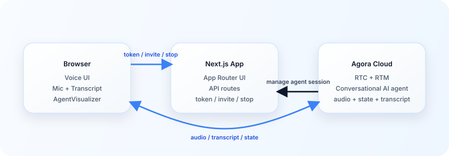

# Unmute — POC de voz com Agora

Converse pelo microfone com a IA e acompanhe a transcrição e latência ao vivo.
Esta POC usa o pipeline gerenciado do Agora (Deepgram Nova-3 → GPT-4o mini → MiniMax), não um modelo speech-to-speech próprio do Agora.
O reconhecimento de fala e as instruções estão em português brasileiro. A voz padrão multilíngue do exemplo foi preservada; valide a pronúncia em uma chamada real.

1. Preencha `NEXT_PUBLIC_AGORA_APP_ID` e `NEXT_AGORA_APP_CERTIFICATE` no `.env.local` (já criado, ignorado pelo Git).
2. Confirme que Conversational AI e Signaling estão habilitados no projeto Agora.
3. Execute `pnpm dev` e abra a URL exibida no terminal (3000 por padrão; nesta sessão, http://127.0.0.1:3001).
4. Clique em **Iniciar conversa**, permita o microfone, fale e teste interromper a resposta.
5. Clique em **Encerrar conversa** para finalizar a sessão.

Não envie o App Certificate pelo chat. Ele permanece no servidor.
Sem as credenciais, é possível abrir a interface e executar typecheck, verify:api e build, mas não validar áudio, transcrição ou latência reais.

Base oficial preservada abaixo, com licença MIT.

## Teste visual de pessoas

A página inicial abre o **Teste de pessoas**, ao lado da conversa Agora. Clique em **Ativar câmera** e permita acesso à câmera ou em **Usar exemplo** para testar sem câmera. Use **Usar traseira** ou **Usar frontal** para escolher a câmera antes de ativá-la ou trocar durante o teste. Pessoas detectadas recebem caixas ou círculos, com confiança e contagem. Ajuste **Confiança mínima** para filtrar resultados. **Parar** desliga a câmera e limpa as marcações; trocar para **Modelo LTQ** também libera a câmera.

O COCO-SSD / TensorFlow.js roda no navegador, com WebGL e alternativa CPU. Os pesos e a foto de exemplo são servidos localmente em `public/vision-demo/` (origem e licença nesse diretório); o primeiro carregamento transfere cerca de 18 MB. O teste de pessoas processa as imagens localmente. A câmera solicita somente vídeo; o microfone continua sob responsabilidade da conversa. Use localhost ou HTTPS para acesso à câmera.

Este teste localiza pessoas, sem identificar indivíduos. Pode falhar ou gerar falsos positivos. As marcações permanecem no teste visual. O adaptador `VisualDetector` em `lib/visual-detection.ts` permite substituir a detecção de pessoas por outro detector que devolva rótulo, confiança e caixas normalizadas, após validação específica para peças do LTQ.

### Testar no celular com ngrok

Para uma demonstração sem o runtime de desenvolvimento, execute `pnpm run build`, depois `pnpm start --hostname 127.0.0.1 --port 3002` e, em outro terminal, `ngrok http 3002`. Abra a URL HTTPS emitida pelo ngrok no navegador do celular, passe pelo aviso **Visit Site**, toque em **Ativar câmera** e permita vídeo. A conversa pede microfone separadamente. Mantenha o servidor e o túnel ativos. Alterações de código exigem novo build e reinício desse servidor.

Evite apontar o túnel direto para `next dev` sem configurar a origem: o Next.js pode bloquear recursos internos de desenvolvimento ([allowedDevOrigins](https://nextjs.org/docs/app/api-reference/config/next-config-js/allowedDevOrigins)). O endereço do ngrok pode mudar ao reiniciar o túnel.

## Demonstração LTQ

Na aba **Modelo LTQ**, a página reúne a gravação do modelo de cadeira acabadora de LTQ gerado no Tripo e a conversa por voz Agora, com o logotipo da Agora. O vídeo em `public/models/ltq-cadeira-acabadora.mp4` é servido pelo próprio Next.js, com reprodução, pausa e tela cheia pelos controles nativos. Ele é uma demonstração visual, sem seleção de peças ou controle por voz.

Abra o painel de voz ou `/voice` e clique em **Iniciar conversa**. Para enviar vídeo ao Agora, toque em **Compartilhar câmera**, permita acesso e pergunte “O que você está vendo?”. Use **Usar frontal** ou **Usar traseira** para trocar a lente, e **Parar vídeo** para interromper o envio sem encerrar a conversa. Ao compartilhar, a chamada libera automaticamente a câmera do teste visual. Se o navegador bloquear o acesso no painel, abra `/voice` em tela cheia e permita o uso da câmera. O GPT-4o mini gerenciado recebe quadros via Agora RTC.

O modelo é conceitual e ainda exige revisão técnica para representar uma cadeira quádrua fielmente. O link **Abrir no Tripo** leva ao modelo original. A exportação GLB exige um plano Tripo que habilite downloads; nenhum GLB foi incluído nesta POC.

---

# Agora Conversational AI Next.js Quickstart

[](https://github.com/AgoraIO-Conversational-AI/agent-quickstart-nextjs/actions/workflows/build-check.yml)
[](./LICENSE)
[](https://nodejs.org/)

Build a production-style voice agent in minutes with Next.js and the Agora Conversational AI Engine, including voice agent visualizer ([Agent UIKit](https://agoraio-conversational-ai.github.io/agent-uikit/)), live transcript, and real-time pipeline latency via `AGENT_METRICS` ([Agent Toolkit](https://github.com/AgoraIO-Conversational-AI/agent-client-toolkit-ts)).

## Prerequisites

- [Node.js 22+](https://nodejs.org/en/download/)
- [pnpm](https://pnpm.io/installation)
- [Agora CLI](https://github.com/AgoraIO-Community/cli)

## Run It

Getting started is quick and easy: install the CLI _(skip if you already have it)_ , scaffold the Next.js quickstart using the Agora CLI, install dependencies, and run.

1. **Install the Agora CLI and sign in**
   _(skip if `agora` is already on your PATH)_:

   macOS and Linux:

   ```bash
   curl -fsSL https://raw.githubusercontent.com/AgoraIO/cli/main/install.sh | sh -s -- --add-to-path
   ```

   Windows PowerShell:

   ```powershell
   irm https://dl.agora.io/cli/install.ps1 | iex
   ```

   If the Windows install command fails in PowerShell, try running the macOS/Linux command from [Git Bash](https://git-scm.com/downloads/win), then open a new terminal and run `agora --help` to confirm the CLI is on your PATH.

   Then verify and sign in:

   ```bash
   agora --help
   agora login
   ```

   If `agora --help` is not found after install, close and reopen your terminal, then try again. If it still fails, check that the installer-added Agora CLI location is on your shell `PATH`.

2. **Scaffold and run**
   `agora init` clones the starter, binds an Agora project, and writes `.env.local`. (replace `my-nextjs-demo` with your own project name):

   ```bash
   agora init my-nextjs-demo --template nextjs
   cd my-nextjs-demo
   pnpm install
   pnpm dev
   ```

3. Open [http://localhost:3000](http://localhost:3000) and click **Start conversation**.

If the agent does not join or transcripts do not appear, run **`agora project doctor --deep`** to check credentials, feature enablement, network reachability, and local env binding.

### Working from a clone of this repository

Use this path if you already cloned **this** repo (for example to contribute or fork):

```bash
git clone https://github.com/AgoraIO-Conversational-AI/agent-quickstart-nextjs.git
cd agent-quickstart-nextjs
agora login
agora project use <your-project>
pnpm install
agora project env write .env.local
agora project doctor --deep
pnpm dev
```

### Deploy to Vercel

[](https://vercel.com/new/clone?repository-url=https%3A%2F%2Fgithub.com%2FAgoraIO-Conversational-AI%2Fagent-quickstart-nextjs&project-name=agent-quickstart-nextjs&repository-name=agent-quickstart-nextjs&env=NEXT_PUBLIC_AGORA_APP_ID,NEXT_AGORA_APP_CERTIFICATE&envDescription=Agora%20credentials%20needed%20to%20run%20the%20app&envLink=https%3A%2F%2Fgithub.com%2FAgoraIO-Conversational-AI%2Fagent-quickstart-nextjs%23run-it&demo-title=Agora%20Conversational%20AI%20Next.js%20Quickstart&demo-description=Official%20Next.js%20quickstart%20for%20building%20browser-based%20voice%20AI%20with%20Agora&demo-image=https%3A%2F%2Fraw.githubusercontent.com%2FAgoraIO-Conversational-AI%2Fagent-quickstart-nextjs%2Fmain%2F.github%2Fassets%2FConversation-Ai-Client.gif)

To populate Vercel env vars from your bound Agora project:

```bash
agora project use <your-project>
agora project env write .env.local
rg "^(NEXT_PUBLIC_AGORA_APP_ID|NEXT_AGORA_APP_CERTIFICATE)=" .env.local
```

Copy those two values into Vercel Project Settings -> Environment Variables.

### Environment variables

Defined in [`env.local.example`](env.local.example).

| Variable                     | Required | Notes                                                            |
| ---------------------------- | :------: | ---------------------------------------------------------------- |
| `NEXT_PUBLIC_AGORA_APP_ID`   |    ✅    | Agora Console → Project → App ID.                                |
| `NEXT_AGORA_APP_CERTIFICATE` |    ✅    | Agora Console → Project → App Certificate. **Server-side only.** |

The default agent configuration in [`app/api/invite-agent/route.ts`](app/api/invite-agent/route.ts) uses Agora-managed STT, LLM, and TTS, so no extra vendor API keys are required for the base quickstart.

## Commands

```bash
# Dev
pnpm dev                # start the Next.js dev server

# Quality
pnpm run lint           # eslint
pnpm run typecheck      # tsc --noEmit
pnpm run doctor         # local prereqs + env binding

# CI / pre-ship
pnpm run verify:api     # API contract checks
pnpm run build          # production build
pnpm run verify         # doctor + lint + typecheck + verify:api + build
```

Run `pnpm run verify` before shipping changes — it covers local prerequisites, lint, type safety, the core API route contracts, and the production build.

## Architecture

<picture>
  <source media="(prefers-color-scheme: dark)" srcset="./system-architecture-dark.svg">
  
</picture>

The browser fetches a combined RTC + RTM token (`buildTokenWithRtm`) from this app, joins the channel using a single RTC client, and uses RTM as the data channel for transcript, agent state, metrics, and error events. The Conversational AI Engine joins the same channel as the shared agent UID in [`lib/agora.ts`](lib/agora.ts) and runs the STT → LLM → TTS pipeline in Agora Cloud.

## What You Get

- browser voice client built with Next.js App Router
- RTC audio plus RTM transcript and state events
- server routes for token generation, invite, and stop
- [`AgentVisualizer`](https://agoraio-conversational-ai.github.io/agent-uikit/) for agent state and a built-in transcript panel for live turns
- per-stage latency header driven by `AGENT_METRICS`
- Agora-managed default STT, LLM, and TTS configuration

## How It Works

1. The browser requests an RTC + RTM token from `/api/generate-agora-token`.
2. The backend invites an Agora cloud agent with `/api/invite-agent`.
3. The browser joins the channel and publishes mic audio.
4. The client receives transcript, agent state, and `AGENT_METRICS` (per-stage latency) events over RTM.
5. On end, the client calls `/api/stop-conversation`, logs out RTM, and unmounts the call view so Agora React hooks clean up RTC publish/join and the local microphone track.

## Optional BYOK

The base `.env.local` contract contains only Agora credentials. If you are migrating from a supported provider, uncomment the matching snippet in [`app/api/invite-agent/route.ts`](app/api/invite-agent/route.ts) and add its variables to your local environment.

```bash
# Deepgram STT
NEXT_DEEPGRAM_API_KEY=...

# OpenAI-compatible LLM
NEXT_LLM_URL=https://api.openai.com/v1/chat/completions
NEXT_LLM_API_KEY=...

# ElevenLabs TTS
NEXT_ELEVENLABS_API_KEY=...
NEXT_ELEVENLABS_VOICE_ID=...
```

## Repo Map

- `app/api/generate-agora-token/route.ts` — issues RTC + RTM tokens
- `app/api/invite-agent/route.ts` — starts the agent session and configures the pipeline
- `app/api/stop-conversation/route.ts` — stops the agent session
- `components/LandingPage.tsx` — entry point: token fetch, RTM login, conversation lifecycle
- `components/ConversationComponent.tsx` — RTC client, transcript state, `AGENT_METRICS`, mic release
- `components/QuickstartConversationLayout.tsx` — in-call header, transcript rail, controls dock
- `components/QuickstartPipelineMetrics.tsx` — per-stage latency chips in the header
- `components/QuickstartTranscriptPanel.tsx` — live transcript rail
- `components/QuickstartPreCallCard.tsx` — pre-call hero card
- `lib/chat-completions.ts` — server-side custom LLM SSE handler used by the chat completions route
- `lib/conversation.ts` — transcript normalization and visualizer state mapping
- `AGENTS.md` — primary agent-facing guide

## Troubleshooting

- **Agent does not join or transcripts are missing:** run `agora project doctor --deep`.
- **`pnpm run doctor` fails:** run `agora project env write .env.local`, then retry.
- **Manual clone / env values:** `agora project use <your-project>` then `agora project env write .env.local`.
- **RTM login fails:** keep [`app/api/generate-agora-token/route.ts`](app/api/generate-agora-token/route.ts) on `RtcTokenBuilder.buildTokenWithRtm` — RTC-only tokens will not satisfy `rtm.login`.
- **Transcript speakers inverted:** check the `uid === "0"` remap in [`components/ConversationComponent.tsx`](components/ConversationComponent.tsx).
- **Agent never appears in channel:** ensure the shared agent UID in [`lib/agora.ts`](lib/agora.ts) is used by both the client and invite route.

## More Docs

- [docs/ai/L0_repo_card.md](./docs/ai/L0_repo_card.md)
- [docs/ai/RECIPE.md](./docs/ai/RECIPE.md)
- [AGENTS.md](./AGENTS.md)

## Contributing

Pull requests welcome — see [CONTRIBUTING.md](./CONTRIBUTING.md) for development setup and conventions.

## Security

Please do **not** open public issues for security reports. Email security@agora.io with details and reproduction steps.

## License

Released under the [MIT License](./LICENSE).

### Circular objetos por voz

Configure `OPENAI_API_KEY` no `.env.local` e `AGORA_ANNOTATION_ORIGIN` com o endereço HTTPS público da POC. Reinicie o servidor e abra uma nova chamada. Com a câmera compartilhada, diga “circule a garrafa”. O Agora pede a marcação, o navegador captura um quadro e o servidor chama a OpenAI. Veja o resultado no quadro congelado e toque em **Voltar ao vídeo**. A localização é aproximada. Para uma descrição sem marcação, pergunte “O que você está vendo?”. A assistente analisa um quadro atual da câmera compartilhada. A POC limita o volume de análises e requer um único processo Next.js para encaminhar as solicitações.

### Consultar um documento por voz

A assistente de manutenção começa pelo relato do operador, consulta a documentação configurada antes de orientar uma intervenção e informa quando falta evidência. Só sugere a câmera quando um detalhe visual continua em aberto.

Guarde o documento em Markdown ou texto UTF-8 numa pasta privada, como `.rag/`. Configure `RAG_DOCUMENT_PATH` e, opcionalmente, `RAG_DOCUMENT_TITLE` no `.env.local`. Se o manual estiver em outro idioma, configure `RAG_DOCUMENT_LANGUAGE` para o Agora enviar termos de busca traduzidos e manter a resposta em português. Reuse `AGORA_ANNOTATION_ORIGIN` como o endereço HTTPS de retorno das ferramentas do Agora. Para citar seções, use títulos Markdown. Se o texto vier de um PDF, separe as páginas com form feed para preservar sua numeração. Após trocar o documento, reinicie o servidor e abra uma chamada nova. Descreva o que você está observando, por exemplo “O rolamento está esquentando e fazendo barulho. O que eu devo verificar?”. A assistente consulta o manual automaticamente para dúvidas de manutenção dentro do escopo da fonte. Se o agente de voz deixar passar uma fala claramente relacionada ao equipamento, a POC pode iniciar a mesma pesquisa pela transcrição final. O Agora chama `consultar_manual_de_manutencao` no MCP `ManualManutencaoLTQ` e recebe o ID imediatamente. A busca híbrida combina BM25 com embeddings da OpenAI e um agente de pesquisa monta a resposta com fonte em segundo plano. Na primeira indexação, os trechos são enviados à API de embeddings e os vetores ficam em `.rag/vectors/`. Nas consultas seguintes, a pergunta original é embutida para a busca semântica e os termos traduzidos ajudam o BM25. A conversa continua disponível. Ao concluir a pesquisa, o servidor envia a pergunta, o resultado e as fontes disponíveis ao modelo do Agora na mesma chamada. O agente pode responder por voz e usar o resultado nas perguntas seguintes. O painel também oferece **Ouvir resposta** para repetir a leitura. A consulta exige `OPENAI_API_KEY`; `OPENAI_RAG_MODEL` é opcional.

### Acompanhar as chamadas no Langfuse

O Compose local fica em `ops/langfuse/compose.yml`. Execute `docker compose --env-file .langfuse/.env -f ops/langfuse/compose.yml up -d` e abra `http://localhost:3100`. `.langfuse/.env` guarda o login e as chaves do projeto local. Configure `LANGFUSE_BASE_URL`, `LANGFUSE_PUBLIC_KEY` e `LANGFUSE_SECRET_KEY` no servidor Next.js. Novas chamadas têm um trace com convite, conexão do microfone, chegada da transcrição final, inicialização do MCP, ferramentas listadas, chamada à ferramenta, roteamento pela transcrição e resultado da pesquisa. Veja `mcp.tools_list` para confirmar a descoberta e `mcp.consultar_manual_de_manutencao` para confirmar o uso. O trace mostra estados e contagens em **Input**, **Output** e **Metadata**, incluindo publicação da câmera, envio local de quadros e resultado da ferramenta de visão. Ele não registra áudio, quadros, texto transcrito ou conteúdo do manual.

### Retry e fallback Feita

Configure `FEITA_API_KEY` no servidor para ativar a Feita como fallback do manual e da análise de câmera. O adaptador em `lib/ai-provider.ts` faz até duas novas tentativas por provedor em falhas transitórias, com backoff exponencial (200 ms, 400 ms) e jitter de até 149 ms, respeitando Retry-After e o prazo total. Se a OpenAI falhar, a Feita recebe a pergunta e os trechos recuperados ou o quadro solicitado. O modelo padrão é `qwen/qwen4-max`, configurável por `FEITA_MODEL`. Para embeddings, o fallback continua sendo a busca por BM25. A voz usa o Agora.

### MCPs da planta LTQ simulada

O Next.js encaminha as consultas de voz pelo mesmo túnel HTTPS de `AGORA_ANNOTATION_ORIGIN`. `TelemetriaCLPLTQ` consulta alarmes, leituras e histórico em um simulador com 17 equipamentos. `DocumentacaoPlantaLTQ` interpreta códigos e tags e busca referências por equipamento. Ambos funcionam independentemente de `ManualManutencaoLTQ`, que continua consultando o documento SKF configurado.

1. Na raiz, com Python 3.11 ou superior, instale os serviços:

   ```sh
   python3 -m venv planta-mcp/.venv
   planta-mcp/.venv/bin/pip install ./planta-mcp
   ```

2. Gere um segredo com `openssl rand -hex 32` e defina o mesmo `PLANTA_MCP_TOKEN` em `.env.local` e no ambiente dos dois processos Python.
3. Em dois terminais, rode `planta-mcp/.venv/bin/planta-mcp telemetria` e `planta-mcp/.venv/bin/planta-mcp documentacao`. Os serviços escutam em loopback nas portas 8011 e 8012. Mantenha-os no mesmo host que o Next.js.
4. Configure `AGORA_ANNOTATION_ORIGIN` com a origem HTTPS pública do Next.js e inicie uma nova chamada após reiniciar o app. O Agora recebe os endpoints `/api/planta/telemetria` e `/api/planta/documentacao` com autenticação Bearer. Deixar o token vazio desativa os dois na voz.
5. Teste “Quais alarmes estão ativos na F5?”, “O que a tag AI012 mede?” e “Como essa variável mudou na última hora?”. As leituras são simuladas.

### Postmortem automático da chamada

Ao encerrar uma nova chamada, a POC gera em segundo plano um relatório em português com identificação, resumo, contexto, linha do tempo, evidências, análise, desfecho, próximas ações, qualidade técnica e limitações. O painel inicial mostra o andamento e os nomes dos arquivos. Os arquivos Markdown e JSON ficam em `files/postmortems/`, fora de `public/` e ignorados pelo Git. O JSON inclui as evidências e a versão do formato. Relatórios existentes devem permanecer privados; a POC agora armazena texto da conversa nessa pasta.

O navegador envia falas concluídas e interrompidas a cada segundo e antes do encerramento. O servidor reúne resultados do manual, análises visuais sem imagens, consultas aos MCPs simulados da planta e diagnósticos. Os horários representam recebimento, não o instante exato da fala. A análise cita os identificadores das falas e eventos e separa relatos, hipóteses e fatos; terminar a ligação não confirma resolução. Resultados de ferramentas ainda pendentes ao encerrar não são aguardados nem incorporados depois. A coleta limita cada sessão a 300 falas, 500 eventos e 160 mil caracteres; limites atingidos são indicados no relatório. Cada fala é limitada a 5 mil caracteres.

A análise reutiliza `OPENAI_API_KEY`, com `FEITA_API_KEY` como fallback. `OPENAI_POSTMORTEM_MODEL` é opcional; por padrão usa `OPENAI_RAG_MODEL` ou `gpt-5.4-mini`. O modelo Feita continua configurado por `FEITA_MODEL`. As evidências coletadas são enviadas ao provedor para a análise. Sem provedor ou em caso de falha, os arquivos ainda são salvos como relatório básico, com as evidências e um aviso. O botão **Tentar gerar novamente** permite até duas novas gerações para relatórios básicos ou falhos enquanto a sessão estiver disponível.

Para testar, atualize o servidor, recarregue a página e inicie uma chamada nova. Relate um problema, consulte uma ferramenta e clique em **Encerrar conversa**. Aguarde **Postmortem salvo** e abra os arquivos na pasta. Chamadas iniciadas antes da atualização não possuem a capacidade de coleta.

O fechamento da página tenta finalizar com `keepalive`; se o navegador não entregar essa requisição, a ausência de heartbeat por dois minutos dispara o relatório como perda de conexão (inclusive quando o navegador suspende uma aba). Essa indicação não comprova que o agente Agora parou. A fila é local, com até dois geradores simultâneos, e requer um único processo Next.js continuamente ativo e disco gravável; reiniciar o processo perde coletas e jobs em memória. Antes de chamar a IA, o job salva o JSON das evidências, que pode ficar com status `generating` se o processo cair. Após uma hora do encerramento, a capacidade de consultar/repetir expira; os arquivos continuam no disco. Esse armazenamento não é adequado ao filesystem efêmero/serverless do Vercel. O Langfuse continua sem transcrições, documentos ou imagens.
